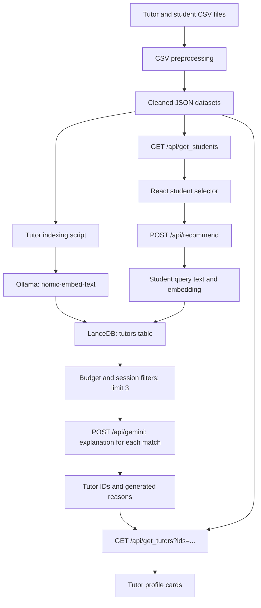

# Tutor Recommendation System

A local tutor-matching prototype built with **Next.js, TypeScript, Ollama and LanceDB**. Select a student profile, retrieve semantically similar tutors within the student's budget and session preference, then inspect the returned tutor profiles in a React interface.

This repository contains the standalone Next.js experiment. A separate Tayari marketplace codebase adapts the approach into an Express service with different schemas and matching rules; that service is not included here.

## What it implements

- CSV preprocessing for tutor and student profiles, including language levels, goals, styles and availability fields.
- Local `nomic-embed-text` embeddings through Ollama and `@langchain/ollama`.
- A persistent LanceDB `tutors` table in `vector_db/`.
- Vector retrieval combined with **inclusive hourly-rate bounds** and an **exact session-preference match**.
- A student selector and tutor cards showing profile details, rates, ratings and availability.

The bundled datasets contain **200 tutor records and 300 student records**.

## Architecture and data flow



**Indexing:** `rec_system/build_tutor_index.ts` loads `dataset/cleaned_tutors.json`, builds text with `concatTextFeatures`, embeds documents in batches of 16 and writes vectors plus selected profile metadata. Creating the table uses `mode: "overwrite"`; rebuilding replaces the existing tutor table.

**Recommendation:** `rec_system/recommend_tutor_for_student.ts` assembles the student's language levels, goals, style, session preference, biography and formatted availability into a query. It embeds that query, opens the local table and retrieves matches satisfying:

```text
rate_per_hour >= student.budget_min
AND rate_per_hour <= student.budget_max
AND session_preference = student.session_preference
```

The HTTP route requests up to **three** matches. For each match, the recommendation function calls the local `/api/gemini` route to request a short explanation, then returns the tutor ID and reason. The browser fetches the corresponding JSON profiles and preserves recommendation order when merging them for display.

## Testing tutor lookups

After installing dependencies, run `npm test` to check empty searches, tutor selection, and recommendation order. These tests run offline without an embedding model or an API key.

Run `npm run test:browser` to exercise student switching in Chromium with mocked search responses. If Chromium is missing, install the matching browser once with `npx playwright install --only-shell chromium`. The tests bundle the real client page and run without a Next.js server.

## Local setup

Prerequisites:

- Node.js **22.9.0 or later** in the Node 22 LTS line, with npm. This satisfies both the locked Next.js requirement and the bundled npm 11.6.4 engine range (`^20.17.0 || >=22.9.0`).
- Ollama installed locally with the `nomic-embed-text` model.
- A platform supported by the native LanceDB dependency, and local filesystem access for the datasets and vector database.

From the repository root:

```bash
git clone https://github.com/codewithgabriel/tutor_recommendation_system_v2.git
cd tutor_recommendation_system_v2
npm ci
```

Start Ollama if it is not already running, then download the embedding model:

```bash
ollama serve
```

In another terminal:

```bash
ollama pull nomic-embed-text
npm run preprocess
npm run build_tutor_index
```

Set the two environment variables described below in `.env.local`, then run `npm run dev`. Open **http://localhost:3000**, choose a student and select **Get Recommendations**. The **Build Index** button currently only logs a message; use the indexing command above.

### Dataset preparation

The preprocessor reads:

- `dataset/tutors_df_raw.csv`
- `dataset/students_df_raw.csv`

It writes `cleaned_tutors.json` and `cleaned_students.json` into the same directory. Cleaned tutor fields include `tutor_id`, `fullname`, `about`, `languages_with_levels`, `teaching_specialities`, `learning_styles`, `learning_goals`, `session_preference`, `rate_per_hour` and `availability`. Student fields include `student_id`, profile/language fields, `learning_goals`, `learning_style`, `session_preference`, `budget_min`, `budget_max` and `availability`.

List fields use comma, semicolon or pipe separators. Language levels use entries such as `english-advanced`. Availability is parsed from pipe-separated `start to end` intervals; use valid date-time strings for the display formatter. The cleaned tutor output includes `learning_styles` (from the `learning_style` or `teaching_style` CSV field) and `learning_goals` (from `learning_goals` or `subjects`, when present). These transformations normalize input but do not provide comprehensive validation.

The preprocessing and index scripts catch and log errors without setting a nonzero exit code. Check their console output and confirm the expected JSON files and `tutors` table were written before querying; a successful process exit alone does not establish that preprocessing/indexing succeeded.

To print matches for every included student from the command line:

```bash
npm run recommend_tutors
```

This batch script uses a smaller student query than the interactive route, so its results need not be identical.

### Configuration

Indexing and the batch retrieval CLI use local Ollama and require no model-provider API key. The interactive recommendation path also calls Gemini for explanations. The Ollama URL (`http://localhost:11434`), embedding model and local database path are set in source.

| Environment variable | Current use |
| --- | --- |
| `GEMINI_API_KEY` | Required for the intended Gemini explanation path. Configure locally outside version control; never put the value in a public README. |
| `APP_BASE_URL` | Origin of the running Next.js app, used by the server to call its own `/api/gemini` endpoint. For local development, use the app's localhost origin and port. |

The Hugging Face token reference is also commented out. TinyLlama is instantiated in the recommendation module, but its invocation is commented out; explanations currently use Gemini instead.

## API surface

| Method | Route | Behavior |
| --- | --- | --- |
| GET | `/api/get_students` | Returns the cleaned, bundled student dataset. |
| GET | `/api/get_tutors` | Omit `ids` to list all cleaned tutors. Pass comma-separated IDs to filter. An empty `ids` filter returns an empty list. |
| POST | `/api/recommend` | Accepts `{ "student": { ... } }`; requests up to three `{ "tutor_id": "...", "reason": "..." }` records. A missing/falsy `student` returns 400; caught failures return 500. |
| POST | `/api/gemini` | Accepts `{ "prompt": "..." }` and requests a Gemini `gemini-2.5-flash` response when configured. Called by the interactive recommendation function for each retrieved tutor. |

For the recommendation request, use a complete student record from `/api/get_students`; see `lib/types.ts` for its intended shape. The route does not enforce that TypeScript shape at runtime.

## Current limitations

- **Explanation handling is incomplete.** The Gemini calls run sequentially, with no explicit timeout, retry or response-status validation in the recommendation function. A failed provider response may produce a missing reason or cause the request to fail. Generated match claims are not independently checked.
- **Availability is not a scheduling constraint.** There is no explicit time-overlap, subject-overlap, language-level or learning-style filter in this prototype. Exact session matching does not interpret `hybrid` or `both` as compatible with `online` automatically.
- **Input protection is incomplete.** The recommendation route checks only whether `student` is truthy; strings and arrays can pass that check. Budget/session values are interpolated into the LanceDB filter string; runtime schema checks and safe handling of filter values are future work. Authentication and rate limiting are not implemented in these route files.
- **This is a local experiment.** The dataset routes expose complete bundled profiles; use only data you are authorized to expose when deploying or replacing the dataset. Native modules, local storage and dataset paths need deployment-specific verification.
- **Quality is not benchmarked here.** No labeled relevance evaluation, recommendation accuracy claim or automated test suite is supplied. `test_gemini` is a provider experiment, not a test suite. Its target, `lib/generate_summary.ts`, logs `GEMINI_API_KEY` directly; do not run it with a real credential until that logging is removed.
- The `recommend_tutor_for_student` npm script currently imports the function without invoking its commented-out example. The legacy `lib/lancedb.ts` helper is not the active retrieval path.

## Build and checks

```bash
npm run lint
npm run build
npx next start
```

Use `npx next start` after a successful build: the checked-in `npm start` script currently adds `--webpack`, which is not a production-start option in Next.js 16.0.7. `next.config.ts` externalizes LanceDB's native modules for the webpack server build.

## Project map

```text
app/page.tsx                         Student selection and result hydration
app/api/recommend/route.ts            Recommendation HTTP handler
app/api/get_students/route.ts         Bundled student dataset endpoint
app/api/get_tutors/route.ts           Tutor detail endpoint
app/api/gemini/route.ts               Gemini explanation endpoint
rec_system/preprocessor.ts           CSV-to-JSON normalization
rec_system/build_tutor_index.ts       Batched embeddings and table overwrite
rec_system/recommend_tutors.ts        Batch recommendation CLI
rec_system/recommend_tutor_for_student.ts  Interactive retrieval function
lib/utils.ts                         Parsing and text-formatting helpers
lib/types.ts                         Intended profile shapes
components/TutorCard.tsx              Tutor presentation
```
